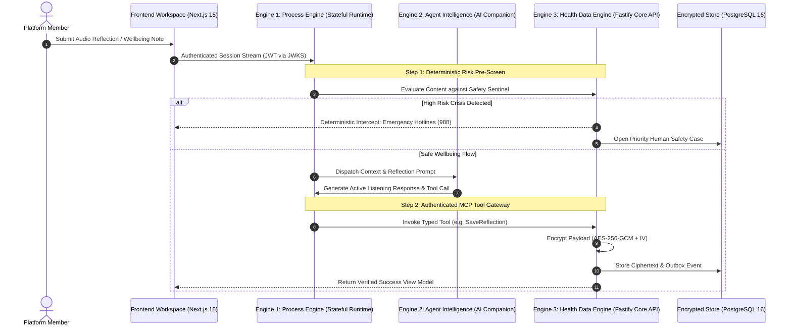
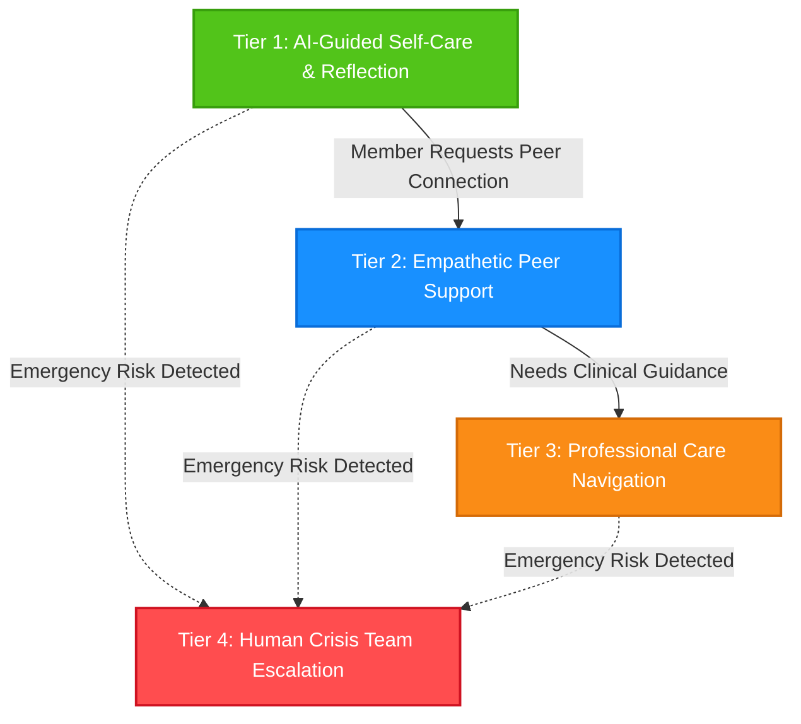
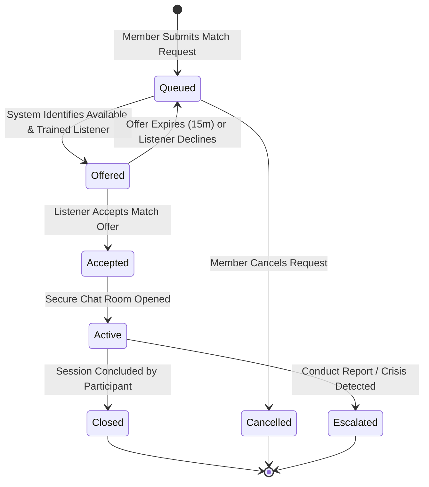
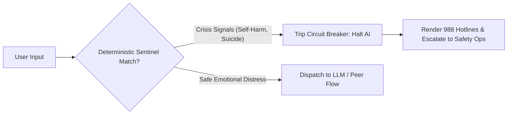
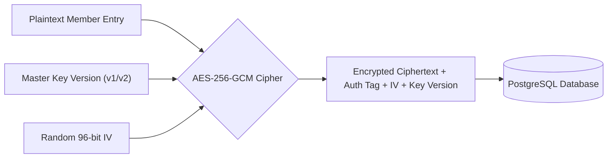
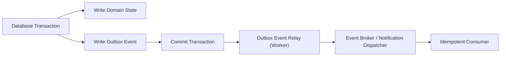

# MindSpace — System Architecture & Clean Architecture Specification

[](https://blog.cleancoder.com/uncle-bob/2012/08/13/the-clean-architecture.html)
[](#)
[](#)
[](#)

This document is the definitive architectural specification for the **MindSpace** peer-support and emotional wellbeing platform. It outlines the platform's core design philosophy, concentric Clean Architecture layers, decoupled three-engine topology, stepped-care continuum, and rigorous health data privacy model.

---

## 📑 Table of Contents

- [1. Executive Architectural Philosophy](#1-executive-architectural-philosophy)
- [2. Clean Architecture Concentric Layers](#2-clean-architecture-concentric-layers)
  - [Layer 1: Domain Entities & Invariants](#layer-1-domain-entities--enterprise-business-rules)
  - [Layer 2: Use Cases & Application Orchestration](#layer-2-use-cases--application-business-rules)
  - [Layer 3: Interface Adapters & Gateways](#layer-3-interface-adapters--gateways)
  - [Layer 4: Frameworks & External Drivers](#layer-4-frameworks--external-drivers)
- [3. The Decoupled Three-Engine Architecture](#3-the-decoupled-three-engine-architecture)
  - [Engine 1: Process Engine (Stateful Workflow Runtime)](#engine-1-process-engine-stateful-workflow-runtime)
  - [Engine 2: Agent Intelligence Engine (Conversational & Voice AI)](#engine-2-agent-intelligence-engine-conversational--voice-ai)
  - [Engine 3: Health Data Engine (Fastify Core API & Store)](#engine-3-health-data-engine-fastify-core-api--store)
- [4. Stepped-Care Care Continuum & State Machines](#4-stepped-care-care-continuum--state-machines)
  - [Care Navigation Tiers](#care-navigation-tiers)
  - [Peer Matching State Machine](#peer-matching-state-machine)
  - [Deterministic Safety Circuit Breaker](#deterministic-safety-circuit-breaker)
- [5. Agentic Framework & The 7 Subagents](#5-agentic-framework--the-7-subagents)
- [6. Security, Cryptography & Data Governance](#6-security-cryptography--data-governance)
  - [Application-Level Envelope Encryption (AES-256-GCM)](#application-level-envelope-encryption-aes-256-gcm)
  - [Zero Direct Database Access for AI](#zero-direct-database-access-for-ai)
  - [Ephemeral In-Memory Voice Pipeline](#ephemeral-in-memory-voice-pipeline)
  - [Cryptographic Principals & JWKS Auth](#cryptographic-principals--jwks-auth)
- [7. Transactional Consistency & Eventing](#7-transactional-consistency--eventing)
- [8. Repository Component Topology](#8-repository-component-topology)

---

## 1. Executive Architectural Philosophy

MindSpace provides non-clinical emotional support and peer connection through structured, safe, and privacy-preserving technology. The architecture is governed by five foundational axioms:

1. **Clean Architecture & Dependency Inversion**: High-level domain logic never depends on low-level technical mechanisms (databases, HTTP frameworks, or AI libraries). All dependencies point strictly inward.
2. **Zero Direct Database Access for AI**: Probabilistic AI agents are untrusted actors and have zero SQL credentials. All mutations occur via typed, authenticated Model Context Protocol (MCP) gateways.
3. **Deterministic Safety Primacy**: High-risk crisis signals (self-harm, suicidal ideation) bypass probabilistic LLM inference and are intercepted by deterministic lexical pattern matchers running at the network perimeter.
4. **Human-in-the-Loop (HITL) Primacy**: AI coordinates, reflects, and navigates; humans provide empathetic care. Volunteer listeners explicitly choose matches, and supervisors govern conduct.
5. **Non-Diagnostic Medical Boundary**: MindSpace is strictly non-clinical. Conversational screeners (PHQ-9/GAD-7 proxies) are triage aids, not diagnostic instruments.

---

## 2. Clean Architecture Concentric Layers

The MindSpace software boundary enforces Uncle Bob's **Clean Architecture**, guaranteeing testability without databases, frameworks, or UI dependencies:

```mermaid
flowchart TD
    subgraph L4["Layer 4: Frameworks & Drivers (External Infrastructure)"]
        F1["PostgreSQL 16 Relational Engine"]
        F2["Fastify 5 HTTP Server / OpenAPI"]
        F3["Next.js 15 / React 19 Client Webapp"]
        F4["Prisma ORM 6 / Migrations"]
        F5["LiveKit WebRTC & Sarvam Speech APIs"]
        subgraph L3["Layer 3: Interface Adapters (Controllers, Gateways, Presenters)"]
            A1["Fastify REST Route Handlers"]
            A2["OpenAPI 3 / Swagger Specifications"]
            A3["MCP Gateways (Typed Agent Tool Contracts)"]
            A4["AES-256-GCM Envelope Cipher Adapter"]
            A5["React / TanStack Query UI Presenters"]
            subgraph L2["Layer 2: Use Cases (Application Business Rules)"]
                U1["Peer Matching & Queue Strategy"]
                U2["Intake & Ephemeral Audio Transcription Flow"]
                U3["Private Journaling, Mood Trends & Goal Check-ins"]
                U4["Deterministic Safety Screening & Crisis Escalation"]
                U5["Transactional Outbox Event Dispatcher"]
                subgraph L1["Layer 1: Domain Entities (Enterprise Business Rules)"]
                    E1["Member & Principal Invariants"]
                    E2["Consent Ledger & Legal Audit Records"]
                    E3["Match Requests & Conversation Lifecycles"]
                    E4["Safety Cases & Risk Indicator Profiles"]
                    E5["Agent Run & Tool Invocation Invariants"]
                end
            end
        end
    end

    L4 --> L3
    L3 --> L2
    L2 --> L1
```



### Layer 1: Domain Entities (Enterprise Business Rules)
The innermost circle contains business data structures and core invariants. They are plain TypeScript interfaces and domain rules independent of any database schema or HTTP framework:
- **`MemberPrincipal`**: Unique identity representation bound to verified cryptographic subjects.
- **`ConsentRecord`**: Append-only permissions ledger determining what data can be processed.
- **`MatchRequest` & `PeerConversation`**: Lifecycle invariants governing peer-to-peer volunteer matching.
- **`SafetyCase` & `RiskProfile`**: Deterministic risk threshold definitions and case status lifecycles.

### Layer 2: Use Cases (Application Business Rules)
Encapsulates all operational workflows of the platform:
- **`PeerMatchingService`**: Evaluates listener availability, topic suitability, and capacity limits.
- **`IntakeWorkflowService`**: Coordinates structured intake questions, validates consent, and processes ephemeral speech transcripts.
- **`WellbeingOrchestrator`**: Manages mood recording, sentiment trajectories, and encrypted reflections.
- **`SafetySentinel`**: Evaluates crisis severity and deterministically suspends standard agent runs to escalate to emergency hotlines.

### Layer 3: Interface Adapters & Gateways
Translates data between the internal use cases and external frameworks:
- **HTTP REST Controllers** (`routes/`): Fastify route schemas validating inputs via Zod and returning OpenAPI-compliant payloads.
- **Model Context Protocol (MCP) Tools**: Strictly typed interfaces exposing domain actions to AI models without SQL access.
- **AES-256-GCM Envelope Cipher**: Transforms plaintext entities into encrypted ciphertext payloads before database storage.
- **React UI Presenters**: Client-side state hooks, TanStack Query connectors, and view models.

### Layer 4: Frameworks & External Drivers
The outermost layer composed of pluggable tools and infrastructure:
- **PostgreSQL 16**: Relational storage engine with Prisma ORM 6 client.
- **Fastify 5**: High-performance HTTP server engine.
- **Next.js 15 & React 19**: Modern SSR and client application delivery.
- **LiveKit / Vapi**: Real-time WebRTC audio transport.

---

## 3. The Decoupled Three-Engine Architecture

To eliminate cross-domain data leakage and guarantee extreme resilience, MindSpace decouples execution into three distinct systems:



### Engine 1: Process Engine (Stateful Workflow Runtime)
- **Session Management**: Multi-turn dialogue context tracking with sliding-window token compression.
- **Deterministic Checkpointing**: State serialization allowing long-running workflows to pause and resume asynchronously.
- **Human-in-the-Loop Suspend/Resume**: Pauses care workflows while waiting for external human decisions (e.g., listener accepting an offer).

### Engine 2: Agent Intelligence Engine (Conversational & Voice AI)
- **Supportive Companionship**: Empathetic, active-listening conversations powered by domain-tuned LLMs.
- **Voice Stream Runtime**: WebRTC bidirectional audio streaming via LiveKit and Sarvam speech synthesis.
- **Strict Guardrails**: Zero SQL credentials, zero raw database access, and prompt-enforced non-clinical boundaries.

### Engine 3: Health Data Engine (Fastify Core API & Store)
- **Data Fortress**: Authoritative owner of PostgreSQL, migrations, and Prisma ORM models.
- **Application Cryptography**: High-entropy AES-256-GCM envelope encryption for all sensitive fields.
- **Deterministic Safety Sentinel**: Perimetric regex/lexical screening that executes before LLM inference.

---

## 4. Stepped-Care Care Continuum & State Machines

MindSpace organizes support into a four-tier stepped care model:



### Peer Matching State Machine

Peer support follows a strict asynchronous lifecycle to protect member safety and volunteer listener workload:



### Deterministic Safety Circuit Breaker



---

## 5. Agentic Framework & The 7 Subagents

To avoid context pollution and agentic drift, MindSpace decomposes care navigation across seven single-responsibility agents supervised by a root Care Orchestrator:

```
                           ┌───────────────────────────┐
                           │     Care Orchestrator     │
                           └─────────────┬─────────────┘
                                         │
        ┌────────────────────────────────┼────────────────────────────────┐
        ▼                                ▼                                ▼
┌───────────────────────┐    ┌───────────────────────┐    ┌───────────────────────┐
│ Intake & Triage Agent │    │ Support Pathway Agent │    │  Wellbeing Companion  │
└───────────────────────┘    └───────────────────────┘    └───────────────────────┘
        ▼                                ▼                                ▼
┌───────────────────────┐    ┌───────────────────────┐    ┌───────────────────────┐
│  Peer Matching Agent  │    │ Care Navigation Agent │    │ Autonomous Follow-Up  │
└───────────────────────┘    └───────────────────────┘    └───────────────────────┘
                                         ▼
                             ┌───────────────────────┐
                             │ Safety Sentinel Agent │
                             └───────────────────────┘
```

1. **Intake & Triage Agent**: Administers non-clinical conversational intake assessments.
2. **Support Pathway Agent**: Recommends appropriate self-help, peer support, or professional resources.
3. **Wellbeing Companion Agent**: Provides grounding techniques, CBT-inspired thought reframing, and active listening.
4. **Peer Matching Agent**: Matches members with suitable volunteer listeners according to availability and preferences.
5. **Care Navigation Agent**: Coordinates directory lookup and scheduling with credentialed mental health professionals.
6. **Autonomous Follow-Up Agent**: Re-engages members asynchronously post-session to monitor wellbeing continuity.
7. **Safety Sentinel Agent**: Continuously monitors interaction telemetry for distress escalation.

---

## 6. Security, Cryptography & Data Governance

### Application-Level Envelope Encryption (AES-256-GCM)

MindSpace never relies solely on storage-layer encryption (disk encryption at rest). Sensitive personal notes, journal entries, and intake responses are encrypted **in application memory** before reaching PostgreSQL:



- **Algorithm**: `AES-256-GCM` with authenticated data verification.
- **Key Rotation**: Version identifiers (`v1`, `v2`) are stored alongside records, enabling zero-downtime key rotation.
- **Granular Ciphering**: Non-sensitive operational metadata (timestamps, status codes) remains queryable; sensitive emotional disclosures are encrypted.

### Zero Direct Database Access for AI
- External LLMs have **no direct connection string** to PostgreSQL.
- Reads and mutations happen exclusively through typed **Model Context Protocol (MCP)** tools.
- Every tool invocation enforces caller JWT role verification and ownership checks (`sub === resource.ownerUserId`).

### Ephemeral In-Memory Voice Pipeline
- Audio recordings sent for speech-to-text transcription are received into ephemeral memory buffers.
- Transcripts are immediately encrypted and persisted.
- **Raw audio buffers are zeroed out immediately post-transcription**; audio files are never persisted to disk or cloud object storage.

### Cryptographic Principals & JWKS Auth
- Authentication uses JSON Web Tokens (JWT) cryptographically validated against a remote JSON Web Key Set (JWKS).
- The token's cryptographic subject (`sub`) is immutable; clients cannot impersonate other principals or query foreign resources.

---

## 7. Transactional Consistency & Eventing

To prevent dual-write inconsistencies between PostgreSQL and external notification/event consumers, MindSpace implements the **Transactional Outbox Pattern**:



- State mutations and event records are committed atomically within the same database transaction.
- Consumers record idempotent consumer receipts to prevent duplicate notifications or side-effects.

---

## 8. Repository Component Topology

```
mindspace/
├── frontend/                   # Frameworks & UI Layer (Next.js 15, Tailwind, React 19)
│   ├── src/app/                # Delivery Layer: App Router Pages & API Proxies
│   ├── src/components/         # Presentation Layer: Design System & Atomic UI
│   ├── src/modules/            # Clean Architecture Feature Modules
│   │   ├── client/             # Member Domain Workspaces
│   │   ├── listener/           # Listener Hub & Availability Desks
│   │   └── admin/              # Operations & Supervisor Desks
│   └── src/lib/                # Interface Adapters: API Connectors & Better Auth
│
├── backend/
│   ├── mindspace-api/          # Engine 3: Core Health Data Engine (Fastify 5 + TypeScript)
│   │   ├── src/routes/         # Interface Adapters: REST Routes & OpenAPI Schemas
│   │   ├── src/services/       # Use Case Layer: Application Workflows
│   │   ├── src/security/       # Interface Adapter: AES-256-GCM Envelope Encryption
│   │   ├── src/types/          # Domain Entities & Data Transfer Objects
│   │   └── prisma/             # Infrastructure: Relational Schema & Migrations
│   │
│   └── mindspace-iam/          # Identity Provider & Remote JWKS Service
│
├── agents/                     # Engine 2: Agent Intelligence & Voice Runtime
│   └── docker-compose.yml      # Containerized LLM & Voice Stream Services
│
├── docs/                       # Architectural Specifications & Deep-Dives
│   ├── MINDSPACE-GUIDE.md      # Platform Operational & Architectural Guide
│   ├── agentic-framework-architecture.md
│   ├── api-and-mcp-specification.md
│   └── security-privacy-guardrails.md
│
├── ARCHITECTURE.md             # This Document (System Architecture Specification)
├── CONTRIBUTING.md             # Contribution & Pull Request Standards
├── SECURITY.md                 # Security Disclosure & Vulnerability Policy
├── LICENSE                     # MIT Open Source License
└── README.md                   # Repository Overview & Quickstart
```

