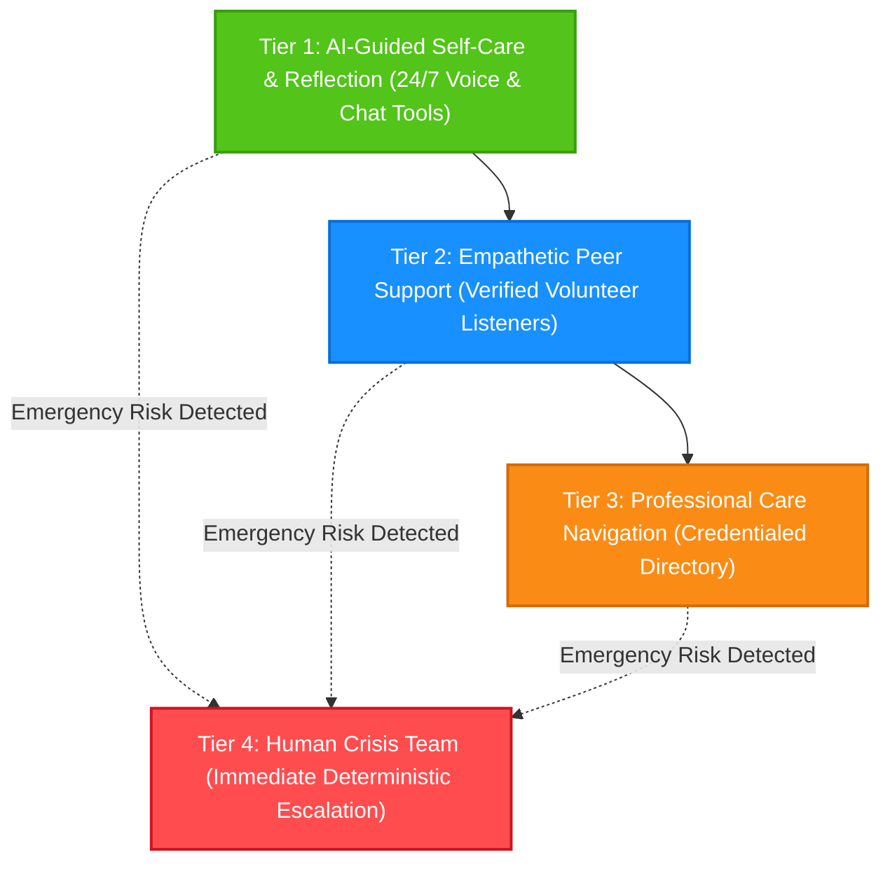
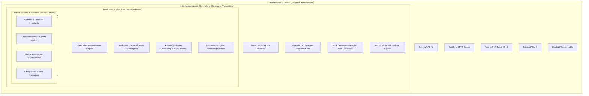
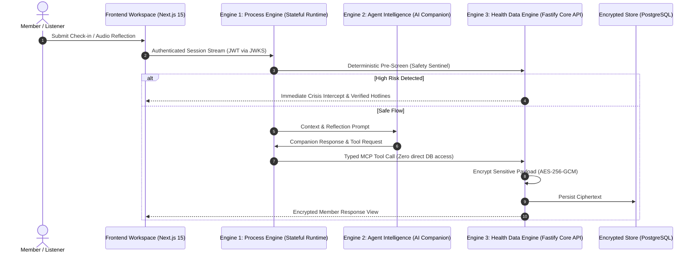

<div align="center">

# 🧠 MindSpace
### Enterprise Peer Support & Emotional Wellbeing Platform

[](https://blog.cleancoder.com/uncle-bob/2012/08/13/the-clean-architecture.html)
[](https://nextjs.org/)
[](https://fastify.dev/)
[](https://www.prisma.io/)
[](#-security--privacy-architecture)
[](https://livekit.io/)
[](./LICENSE)

<p align="center">
  <b>A resilient, stepped-care platform connecting members with trained volunteer listeners, non-clinical AI wellbeing companions, and deterministic crisis escalation.</b>
</p>

[Architecture Spec](./ARCHITECTURE.md) •
[Quickstart](#-quickstart-guide) •
[Clean Architecture](#-clean-architecture--system-design) •
[Features](#-stepped-care-platform-features) •
[API Reference](#-api-routes--dashboard-read-models) •
[Security](#-security--privacy-architecture) •
[Contributing](./CONTRIBUTING.md)

---

</div>

## 📑 Table of Contents

- [Vision & Core Philosophy](#-vision--core-philosophy)
- [Clean Architecture & System Design](#-clean-architecture--system-design)
  - [Concentric Domain Layers](#the-concentric-domain-layers)
  - [Decoupled Three-Engine Architecture](#the-decoupled-three-engine-architecture)
  - [Detailed Specification Document (ARCHITECTURE.md)](./ARCHITECTURE.md)
- [Stepped-Care Platform Features](#-stepped-care-platform-features)
- [Repository Clean Structure](#-repository-clean-structure)
- [Technology Stack](#-technology-stack)
- [Quickstart Guide](#-quickstart-guide)
  - [Prerequisites](#prerequisites)
  - [Step 1: Start Backend API & PostgreSQL](#step-1-start-backend-api--postgresql)
  - [Step 2: Start AI Voice & Chat Agent Service](#step-2-start-ai-voice--chat-agent-service)
  - [Step 3: Start Next.js Frontend Client](#step-3-start-nextjs-frontend-client)
- [API Routes & Dashboard Read Models](#-api-routes--dashboard-read-models)
- [Testing & Quality Assurance](#-testing--quality-assurance)
- [Security & Privacy Architecture](#-security--privacy-architecture)
- [Important Safety & Non-Clinical Notice](#-important-safety--non-clinical-notice)
- [License & Community](#-license--community)

---

## 🌟 Vision & Core Philosophy

**MindSpace** is an agentic emotional wellbeing and peer-support platform built to bridge the gap between personal distress and human connection. Rather than operating as an unconstrained conversational chatbot or a rigid self-help library, MindSpace functions as an **active, continuous care navigator** adhering to a structured **Stepped-Care Continuum**:



---

## 🏛️ Clean Architecture & System Design

MindSpace is architected according to **Clean Architecture principles (Uncle Bob)**. The architecture strictly enforces the **Dependency Inversion Principle**: inward-pointing dependencies where business rules remain pure and completely decoupled from databases, HTTP frameworks, and UI libraries.

### The Concentric Domain Layers



| Clean Architecture Layer | Responsibility | MindSpace Implementation |
|---|---|---|
| **1. Domain Entities** | Enterprise Business Rules & Invariants | Member Profiles, Match Requests, Peer Conversations, Journal Entries, Consent Records, Safety Rules |
| **2. Use Cases** | Application Business Rules & Orchestration | Peer Matching Algorithm, Intake & Transcription Flow, Mood & Goal Tracking, Deterministic Risk Sentinel |
| **3. Interface Adapters** | Data translation between Use Cases and external world | Fastify Route Handlers, OpenAPI Specifications, React/TanStack Presenters, Model Context Protocol (MCP) Gateways, AES-256-GCM Ciphers |
| **4. Frameworks & Drivers** | External tools, databases, web servers, and third-party APIs | PostgreSQL Database, Prisma ORM Engine, Docker Compose, Fastify HTTP Server, Next.js Web App, LiveKit / Sarvam Audio APIs |

---

### The Decoupled Three-Engine Architecture

MindSpace guarantees privacy, compliance, and resiliency by decoupling execution into three distinct, specialized engines:



#### Core Architectural Guarantees:
1. **Zero Direct DB Access for AI**: AI models and external agents have no database credentials. All reads and mutations occur via authenticated, typed tool endpoints.
2. **Deterministic Safety Sentinel**: Crisis screening runs deterministic lexical and pattern matching in the data gateway *prior* to any LLM inference.
3. **Application-Level Encryption**: All sensitive member disclosures, journal entries, and intake responses are encrypted using **AES-256-GCM** before touching PostgreSQL disk storage.

---

## 🚀 Stepped-Care Platform Features

### 👤 1. Identity, Consent & Member Privacy
- **Owner-Scoped RBAC**: Roles (`member`, `listener`, `supervisor`, `safety_admin`, `admin`) strictly enforce least privilege.
- **Explicit Consent Ledger**: Granular, append-only consent tracking for intakes, audio processing, and peer matching.
- **GDPR / Privacy Compliance**: Self-service privacy requests (export / erasure) with cryptographic soft-delete support.

### 💬 2. Peer Support & Listener Hub
- **Consent-Backed Matching**: Members create tailored support requests; available, trained listeners receive targeted match offers.
- **End-to-End Encrypted Conversations**: Private text messaging between matched members and listeners.
- **Listener Governance**: Onboarding pipeline, verified training records, and supervisor review with conduct reporting.

### 🤖 3. Multimodal Voice & Chat Wellbeing Tools
- **Conversational Companionship**: Empathetic, supportive active-listening agents (voice-enabled via LiveKit / Vapi).
- **Consented Voice Transcription**: Audio is streamed in-memory to an OpenAI-compatible speech-to-text service; only encrypted transcripts are stored. Raw audio is never persisted.
- **Guided Self-Help**: Private journaling with sentiment tracking, mood logs, and structured reflection exercises.

### 📊 4. Role-Specific Unified Dashboards
- **Member Workspace**: Active goals, mood trends, upcoming peer chats, and self-help tools.
- **Listener Hub**: Assigned match offers, active peer conversations, availability schedules, and training resources.
- **Supervisor Console**: Real-time listener roster, conduct review cases, and peer-matching throughput.
- **Safety Operations Desk**: Emergency escalation desk, verified local crisis hotline directory, and risk review cases.
- **Platform Admin Panel**: Outbox events, audit trail, system health probes, and role assignments.

---

## 📁 Repository Clean Structure

```
mindspace/
├── frontend/                   # Frameworks & UI Layer (Next.js 15, React 19, Tailwind CSS)
│   ├── src/
│   │   ├── app/                # Next.js App Router (Pages, Layouts, API Routes)
│   │   ├── components/         # Reusable Atomic UI Components (Buttons, Dialogs, Cards)
│   │   ├── modules/            # Feature-Driven Clean Architecture Modules
│   │   │   ├── client/         # Member Workspaces (Mood, Goals, Chat, Journal)
│   │   │   ├── listener/       # Listener Hub (Offers, Chats, Availability)
│   │   │   └── admin/          # Supervisor & Safety Ops Desks
│   │   ├── hooks/              # Custom Application & Data Fetching Hooks
│   │   └── lib/                # Adapters, Better Auth Client & API Connectors
│   ├── prisma/                 # Frontend Local Database Schema & Migrations
│   └── README.md               # Frontend Module Documentation
│
├── backend/
│   ├── mindspace-fastapi/      # Engine 3: Core Health Data Engine (Python 3.14 + FastAPI + SQLAlchemy Async)
│   │   ├── app/
│   │   │   ├── core/           # Config, AES-256-GCM Envelope Encryption & DB Async Session
│   │   │   ├── models/         # SQLAlchemy PostgreSQL Relational Models (49 Tables)
│   │   │   ├── schemas/        # Pydantic V2 Request & Response Schemas
│   │   │   ├── routers/        # Clean Architecture REST Controllers (Member, Peer, Wellbeing, Dashboards)
│   │   │   └── main.py         # FastAPI Application Factory & OpenAPI 3 Setup
│   │   └── tests/              # Pytest & HTTPX Async End-to-End Test Suite
│   │
│   ├── mindspace-api/          # Legacy Fastify Node.js Reference Implementation
│   └── mindspace-iam-py/         # Identity Provider & Remote JWKS Service
│
├── agents/                     # Engine 2: Agent Intelligence & Voice Runtime
│   ├── docker-compose.yml      # Voice & Chat Agent Container Orchestration
│   ├── .env.example            # Model Keys & Audio Streaming Configurations
│   └── README.md               # Agent Service Architecture & Setup
│
├── docs/                       # Architectural Blueprints & Operational Guides
│   ├── MINDSPACE-GUIDE.md      # Complete Architectural & Operational Guide
│   ├── agentic-framework-architecture.md
│   ├── api-and-mcp-specification.md
│   └── security-privacy-guardrails.md
│
├── CONTRIBUTING.md             # Contribution Guidelines & Git Flow
├── SECURITY.md                 # Security Policy & Vulnerability Reporting
├── LICENSE                     # MIT Open-Source License
└── README.md                   # Repository Root Documentation
```

---

## 🛠️ Technology Stack

| Domain | Technology | Description |
|---|---|---|
| **Frontend Framework** | [Next.js 15 (App Router)](https://nextjs.org/) | Server & client components, streaming SSR |
| **Frontend UI Library** | [React 19](https://react.dev/) + [Tailwind CSS](https://tailwindcss.com/) | Atomic styling, high accessibility design system |
| **Backend Framework** | [Python 3.14 + FastAPI](https://fastapi.tiangolo.com/) | High-performance async REST framework with automatic OpenAPI docs |
| **Database & ORM** | [PostgreSQL 16](https://www.postgresql.org/) + [SQLAlchemy Async / AsyncPG](https://docs.sqlalchemy.org/) | Async relational persistence with connection pooling |
| **Security & Ciphers** | AES-256-GCM + SHA-256 | Application-level envelope encryption with versioned keys |
| **Authentication** | [Better Auth](https://better-auth.com/) / JOSE (JWT + JWKS) | Cryptographic signature verification, owner-bound principals |
| **Realtime Audio / Voice** | [LiveKit](https://livekit.io/) & [Vapi](https://vapi.ai/) | WebRTC bidirectional audio streaming |
| **Containerization** | [Docker](https://www.docker.com/) & [Docker Compose](https://docs.docker.com/compose/) | Isolated local and production deployment environments |

---

## ⚙️ Quickstart Guide

### Prerequisites
- **Node.js** `>= 22.0.0`
- **pnpm** `>= 9.0.0`
- **Docker Desktop** (Engine 24+)
- **Git**

---

### Start the complete Docker stack (Windows PowerShell)

From the repository root, make sure the environment files exist and fill in real provider credentials before starting the agents:

```powershell
Set-Location D:\Mindspace

if (-not (Test-Path backend\mindspace-iam-py\.env)) {
  Copy-Item backend\mindspace-iam-py\.env.example backend\mindspace-iam-py\.env
}
if (-not (Test-Path frontend\.env)) {
  Copy-Item frontend\.env.example frontend\.env
}
if (-not (Test-Path agents\.env)) {
  Copy-Item agents\.env.example agents\.env
}
```

Set `BETTER_AUTH_SECRET` in `backend\mindspace-iam-py\.env`, and set the required `API_KEY`, `SARVAM_API_KEY`, and `JINA_API_KEY` values in `agents\.env`. Then start each Compose project:

```powershell
docker compose -f backend\mindspace-fastapi\docker-compose.yml up -d --build
docker compose -f backend\mindspace-iam-py\docker-compose.yml up -d --build
docker compose -f frontend\docker-compose.yml up -d --build
docker compose -f agents\docker-compose.yml up -d
```

Check status and follow logs:

```powershell
docker compose -f backend\mindspace-fastapi\docker-compose.yml ps
docker compose -f backend\mindspace-iam-py\docker-compose.yml ps
docker compose -f frontend\docker-compose.yml ps
docker compose -f agents\docker-compose.yml ps

docker compose -f backend\mindspace-fastapi\docker-compose.yml logs -f mindspace-fastapi
docker compose -f backend\mindspace-iam-py\docker-compose.yml logs -f mindspace-iam
docker compose -f frontend\docker-compose.yml logs -f frontend
docker compose -f agents\docker-compose.yml logs -f previsit-agent
```

Open the frontend at [http://localhost:4000](http://localhost:4000), FastAPI docs at [http://localhost:8080/docs](http://localhost:8080/docs), IAM at [http://localhost:5001](http://localhost:5001), and agents at [http://localhost:8018](http://localhost:8018). Stop the services without deleting database data:

```powershell
docker compose -f agents\docker-compose.yml down
docker compose -f frontend\docker-compose.yml down
docker compose -f backend\mindspace-iam-py\docker-compose.yml down
docker compose -f backend\mindspace-fastapi\docker-compose.yml down
```

---

## 📡 API Routes & Dashboard Read Models

The Fastify backend provides strict, role-scoped endpoints documented via OpenAPI 3 / Swagger:

<details>
<summary><b>Click to expand API Route Reference</b></summary>

### Identity, Member, Consent & Intake
| Method | Path | Purpose |
|---|---|---|
| `GET` | `/api/v1/me` | Read authenticated principal and roles |
| `GET`, `PUT` | `/api/v1/members/me/profile` | Read or update member profile |
| `GET`, `POST` | `/api/v1/consents` | Read consent ledger or record a consent decision |
| `POST`, `GET` | `/api/v1/intakes` | Create or list member intakes |
| `POST` | `/api/v1/intakes/{id}/transcription` | Upload audio for ephemeral in-memory transcription |

### Wellbeing & Self-Help
| Method | Path | Purpose |
|---|---|---|
| `GET`, `POST` | `/api/v1/wellbeing/moods` | Record or view self-reported mood tracking entries |
| `GET`, `POST`, `PUT`, `DELETE` | `/api/v1/wellbeing/journal` | AES-256-GCM encrypted private journaling |
| `GET`, `POST` | `/api/v1/wellbeing/goals` | Manage personal wellbeing goals and check-ins |
| `GET`, `POST` | `/api/v1/wellbeing/reflections` | Create and complete structured non-clinical reflections |

### Peer Support & Listener Operations
| Method | Path | Purpose |
|---|---|---|
| `GET`, `POST` | `/api/v1/peer/match-requests` | Create or view consent-backed match requests |
| `GET` | `/api/v1/listeners/me/offers` | View pending match offers assigned to listener |
| `POST` | `/api/v1/peer/matches/{id}/accept` | Accept an assigned peer-support offer |
| `GET`, `POST` | `/api/v1/peer/conversations/{id}/messages` | Encrypted peer conversation messages |
| `GET`, `POST` | `/api/v1/listeners/me/availability` | Read or update listener availability |

### Role-Specific Dashboard Read Models
| Role | Method | Path | Purpose |
|---|---|---|---|
| **Member** | `GET` | `/api/v1/members/me/summary` | Weekly check-in stats, active goals, open peer conversations |
| **Listener** | `GET` | `/api/v1/listeners/me/summary` | Profile status, open offers, active conversations, training records |
| **Supervisor** | `GET` | `/api/v1/operations/supervisor/summary` | Listener roster, open conduct reports, assignment status |
| **Safety Ops** | `GET` | `/api/v1/operations/safety/summary` | Open safety cases, pending handoffs, emergency crisis logs |
| **Admin** | `GET` | `/api/v1/admin/platform/overview` | Platform health, active roles, outbox events, audit metrics |

</details>

---

## 🧪 Testing & Quality Assurance

MindSpace enforces strict automated testing across all modules:

```bash
# Run Backend Unit, Encryption & Integration Tests
cd backend/mindspace-api
pnpm test

# Run Frontend Linter & Typechecks
cd frontend
pnpm lint
pnpm build
```

---

## 🔒 Security & Privacy Architecture

MindSpace handles sensitive emotional disclosures under strict architectural privacy guarantees:

1. **Application-Level Envelope Encryption**:
   - High-entropy AES-256-GCM with unique 96-bit initialization vectors (IV) per record.
   - Versioned encryption keys with automated migration capabilities.
2. **Ephemeral Audio Pipeline**:
   - Audio recordings are processed solely in memory.
   - Converted into text transcripts via authenticated external providers.
   - Audio buffers are zeroed out immediately post-transcription.
3. **Owner-Bound JWT Principals**:
   - Access tokens are verified against remote JWKS.
   - User ownership is strictly tied to the token's cryptographic subject (`sub`), preventing Insecure Direct Object Reference (IDOR) attacks.
4. **Append-Only Tamper-Evident Audit Logging**:
   - Sensitive access, consent alterations, and administrative role grants are permanently recorded in the audit log.

---

## ⚠️ Important Safety & Non-Clinical Notice

> [!IMPORTANT]
> - **Non-Clinical Platform**: MindSpace is an emotional wellbeing and peer-support platform. It **does not** provide clinical diagnosis, medical treatment, prescription management, or electronic medical record (EMR/FHIR) services.
> - **Volunteer Listeners**: Volunteer listeners provide non-judgmental, active listening and companionship. They are not licensed psychologists, psychiatrists, or medical professionals.
> - **Deterministic Crisis Escalation**: MindSpace maintains deterministic safety circuit breakers. If a user discloses imminent danger, self-harm, or an acute emergency, the platform immediately presents verified crisis hotlines (such as **988** in the US/Canada, or local emergency services) and directs the user to immediate professional human intervention.

---

## 📄 License & Community

- **License**: This project is open-source under the [MIT License](./LICENSE).
- **Contributing**: Please read our [Contributing Guide](./CONTRIBUTING.md) before opening PRs.
- **Security Disclosures**: Please report security vulnerabilities responsibly as described in our [Security Policy](./SECURITY.md).
